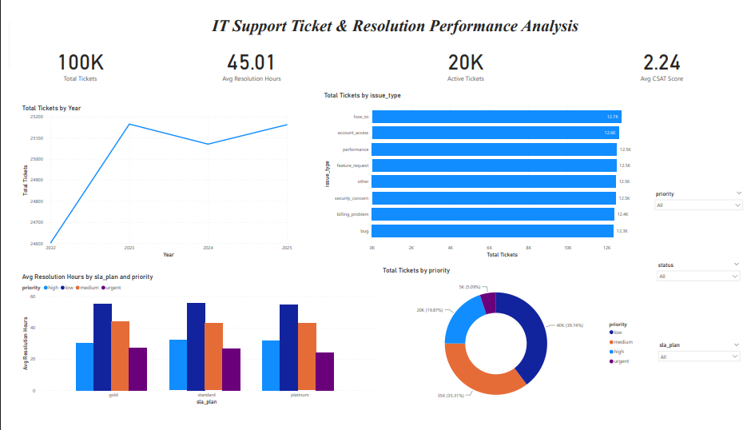

# 📊 IT Support Ticket & Resolution Performance Analysis

An end-to-end data analytics project built with **Power BI, SQL, and Excel** to analyze 100,000+ IT support tickets, resolution times, SLA compliance, and recurring technical issues.

## 📈 Dashboard Preview

## 🔍 Key Insights & Features
* **Executive KPIs:** Tracks **100K Total Tickets**, **45.01 Avg Resolution Hours**, **20K Active Tickets**, and **2.24 Avg CSAT Score**.
* **Ticket Trends & Recurring Issues:** Visualizes multi-year ticket volume growth and ranks top issue categories (`how_to`, `account_access`, `performance`, `feature_request`).
* **SLA & Priority Breakdown:** Compares resolution turnaround across `gold`, `standard`, and `platinum` SLA tiers segmented by `urgent`, `high`, `medium`, and `low` priority levels.
* **Dynamic Filtering:** Interactive dropdown slicers for **Priority**, **Status**, and **SLA Plan**.

## 🛠️ Tools & Files Included
* `IT_Support_Ticket_Dashboard.pbix` — Interactive Power BI Desktop report and DAX measures.
* `ticket_analysis.sql` — SQL queries for aggregations, SLA breakdowns, and resolution metrics.
* `IT_Support_Tickets_Cleaned.xlsx` — Cleaned dataset prepared in Excel.
